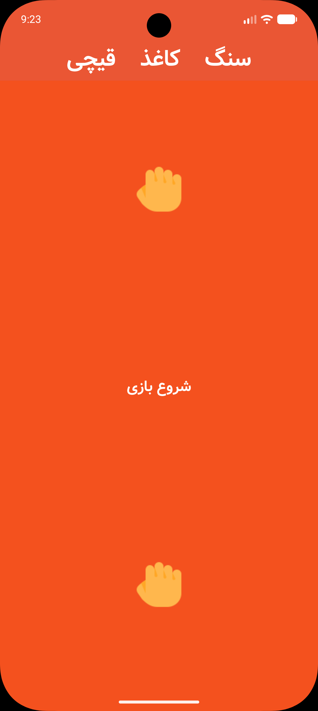
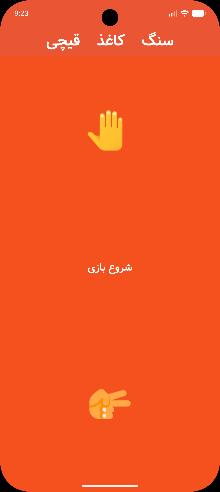
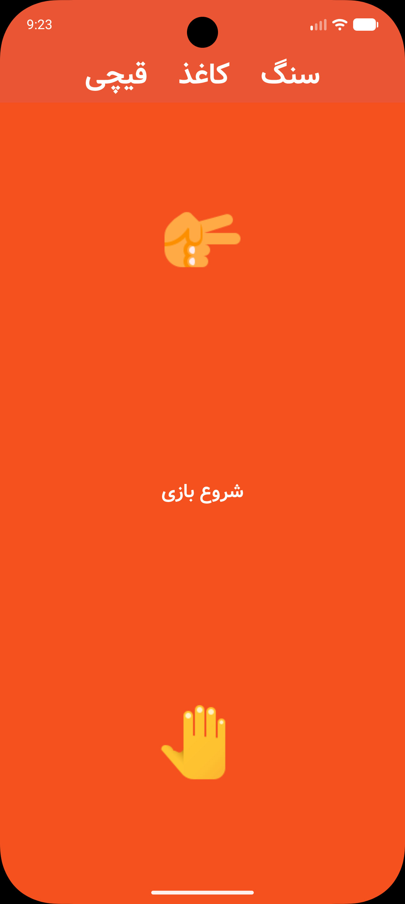

<div dir="rtl" align="right">

[English](README.md) | [فارسی](README.fa.md)

# سنگ، کاغذ، قیچی


[](LICENSE)

یک اپ ساده با Flutter و رابط فارسی برای انتخاب تصادفی دو دست سنگ، کاغذ یا قیچی. با زدن دکمهٔ **شروع بازی**، برای هر طرف یک دست به‌صورت تصادفی انتخاب می‌شود.

## اسکرین‌شات‌ها

| سنگ / سنگ | کاغذ / قیچی | قیچی / کاغذ |
| :---: | :---: | :---: |
|  |  |  |

تصاویر در پوشهٔ `assets/screenshots/` قرار دارند. برای عوض کردن اسکرین‌شات‌ها می‌توانید فایل‌ها را با همین نام جایگزین کنید یا مسیرها را در هر دو README تغییر دهید. این تصاویر فقط برای مستندات هستند و لازم نیست در `pubspec.yaml` ثبت شوند. موقع commit کردن مستندات، این پوشه را هم اضافه کنید تا تصاویر در GitHub نمایش داده شوند.

## قابلیت‌های اصلی

- انتخاب تصادفی و مستقل دو دست، با یک بار زدن دکمه.
- نمایش سنگ، کاغذ و قیچی با تصاویر PNG داخل پروژه.
- عنوان و دکمهٔ فارسی، با فونت **Vazir** که همراه اپ قرار دارد.
- یک صفحه با ویجت‌های Material و تم نارنجی؛ دو دست بالا و پایین صفحه و دکمهٔ شروع در وسط قرار می‌گیرند.
- اجرای آفلاین؛ اپ به بک‌اند، درخواست شبکه، حساب کاربری یا تنظیم سرویس خارجی نیاز ندارد.

### نحوهٔ کار

مقدار اولیهٔ هر دو دست `1` است. با زدن دکمه، برای هر دست عبارت `Random().nextInt(3) + 1` اجرا می‌شود و بعد `setState` صفحه را با تصویر متناظر از پوشهٔ `assets/images/` به‌روزرسانی می‌کند. چون انتخاب‌ها تصادفی هستند، ممکن است یک دست بعد از زدن دکمه تغییری نکند.

این نسخه فقط دو دست را به‌صورت تصادفی انتخاب و نمایش می‌دهد و هنوز یک بازی کامل بازیکن در برابر کامپیوتر نیست. انتخاب دستی، تشخیص برنده، امتیازدهی و ذخیرهٔ دورهای قبلی در آن پیاده‌سازی نشده‌اند.

## تکنولوژی‌ها و معماری

ساختار اپ **تک‌فایلی و مبتنی بر ویجت** است. رابط کاربری و State بازی هر دو در `lib/main.dart` قرار دارند. لایه‌های جداگانهٔ Data، Domain و Presentation، Repository، Service یا تنظیمات مسیریابی وجود ندارند. پروژه از Clean Architecture، MVVM یا ساختار feature-first استفاده نمی‌کند.

### مدیریت وضعیت (State Management)

ویجت `GameApplication` از نوع `StatefulWidget` است. کلاس `_GameApplicationState` مقدارهای `top` و `bottom` را نگه می‌دارد و با `setState` خود Flutter آن‌ها را به‌روزرسانی می‌کند. از BLoC، Provider، Riverpod یا پکیج دیگری برای State Management استفاده نشده است.

### پکیج‌ها و فایل‌های همراه اپ

وابستگی‌های مستقیم در `pubspec.yaml`:

- **`flutter`** — وابستگی SDK برای ویجت‌ها، رابط Material، تم و بارگذاری فایل‌های همراه اپ.
- **`cupertino_icons: ^1.0.8`** — پکیج آیکون که در پروژه تعریف شده، ولی صفحهٔ فعلی از آیکون‌های Cupertino استفاده نمی‌کند.

وابستگی‌های توسعه:

- **`flutter_test`** — ابزارهای Flutter برای تست ویجت‌ها.
- **`flutter_lints: ^6.0.0`** — قواعد پیشنهادی تحلیل کد که از طریق `analysis_options.yaml` فعال شده‌اند.

انتخاب تصادفی با **`dart:math`** انجام می‌شود؛ این کتابخانه بخشی از Dart SDK است، نه یک پکیج جداگانه. وابستگی دیگری برای شبکه، ذخیره‌سازی محلی یا رابط کاربری وجود ندارد. `build_runner` و تنظیمات تولید کد هم در پروژه نیستند.

تصاویر دست‌ها در فایل‌های `assets/images/1.png`، `2.png` و `3.png` قرار دارند. فایل فونت `assets/fonts/vb.ttf` هم با نام خانوادهٔ `Vazir` ثبت شده است.

### ساختار پوشه‌ها

<div dir="ltr" align="left">

```text
lib/
└── main.dart                 # نقطهٔ شروع، GameApplication، رابط کاربری و وضعیت دست‌ها
```

</div>

<div dir="ltr" align="left">

```text
rock_paper_scisser/
├── lib/
│   └── main.dart
├── assets/
│   ├── images/               # سه تصویر دست مورد استفادهٔ اپ
│   ├── fonts/
│   │   └── vb.ttf            # فونت Vazir
│   └── screenshots/          # تصاویر مورد استفاده در READMEها
├── test/
│   └── widget_test.dart      # تست اولیهٔ شمارنده؛ توضیح در بخش تست‌ها
├── android/                  # پروژهٔ پلتفرم Android
├── web/                      # پروژهٔ پلتفرم وب
├── windows/                  # پروژهٔ پلتفرم Windows
├── analysis_options.yaml
├── pubspec.yaml
├── pubspec.lock
├── .gitattributes            # حذف کدهای اولیه و تولیدشده از آمار Linguist
├── LICENSE
├── README.md
└── README.fa.md
```

</div>

درخت `lib/` فقط فایل `main.dart` را دارد؛ نقطهٔ شروع اپ، ویجت اصلی، رابط کاربری و State دست‌ها در همین فایل هستند. پوشه‌های `images/` و `fonts/` فایل‌های مورد استفادهٔ اپ را نگه می‌دارند و `screenshots/` برای تصاویر README است. فایل `widget_test.dart` هنوز تست اولیهٔ شمارنده است که پایین‌تر توضیح داده شده است.

پروژهٔ پلتفرم برای **Android، وب و Windows** در این نسخه وجود دارد. پوشه‌های iOS، macOS و Linux در مخزن فعلی قرار ندارند.

## راه‌اندازی

### ۱. پیش‌نیازها

- Git و نسخه‌ای از Flutter SDK که **Dart نسخهٔ ۳٫۱۲٫۰ یا بالاتر، ولی پایین‌تر از ۴٫۰٫۰** را همراه داشته باشد؛ مطابق محدودیت `sdk: ^3.12.0`. در فایل پروژه نسخهٔ مشخصی از Flutter پین نشده است.
- یک ادیتور مثل Android Studio یا VS Code با پشتیبانی Flutter و Dart.
- ابزارهای پلتفرم موردنظر: Android SDK و شبیه‌ساز یا دستگاه واقعی برای Android؛ مرورگر Chrome برای وب؛ و Visual Studio با workload به نام **Desktop development with C++** برای نسخهٔ دسکتاپ Windows.

وضعیت محیط را بررسی کنید:

<div dir="ltr" align="left">

```bash
flutter --version
flutter doctor
```

</div>

نام پکیج `rock_paper_scisser` و نسخهٔ آن `1.0.0+1` است. این پروژه یک اپلیکیشن با تنظیم `publish_to: 'none'` است و برای انتشار به‌عنوان پکیج در pub.dev در نظر گرفته نشده است.

### ۲. دریافت پروژه

<div dir="ltr" align="left">

```bash
git clone https://github.com/mehrshadkhv/rock_paper_scisser.git
cd rock_paper_scisser
```

</div>

اگر پروژه را از قبل روی سیستم دارید، کافی است پوشهٔ اصلی آن را باز کنید.

### ۳. نصب وابستگی‌ها

<div dir="ltr" align="left">

```bash
flutter pub get
```

</div>

نیازی به API Key، فایل تنظیمات محیطی، راه‌اندازی بک‌اند یا اجرای دستور تولید کد نیست.

### ۴. اجرای اپ

شبیه‌ساز را اجرا کنید یا دستگاه را وصل کنید، سپس دستورهای زیر را بزنید:

<div dir="ltr" align="left">

```bash
flutter devices
flutter run
```

</div>

برای انتخاب یک دستگاه مشخص، شناسهٔ آن را از خروجی `flutter devices` بردارید و در دستور `flutter run -d <device-id>` قرار دهید. برای پلتفرم‌های وب و Windows موجود در پروژه:

<div dir="ltr" align="left">

```bash
flutter run -d chrome
flutter run -d windows
```

</div>

اجرای نسخهٔ دسکتاپ Windows به سیستم‌عامل Windows و ابزارهای گفته‌شده نیاز دارد. وجود پوشهٔ یک پلتفرم فقط نشان‌دهندهٔ تنظیمات پروژه است و به معنی تست شدن همهٔ پلتفرم‌ها نیست.

## بررسی کد و تست‌ها

<div dir="ltr" align="left">

```bash
flutter analyze
flutter test
```

</div>

**مشکل فعلی تست:** فایل `test/widget_test.dart` هنوز تست شمارندهٔ پیش‌فرض Flutter است. این تست دنبال متن `0` و آیکون افزودن می‌گردد که در اپ وجود ندارند؛ بنابراین رفتار بازی را بررسی نمی‌کند و انتظار می‌رود شکست بخورد. باید با یک تست ویجت برای `GameApplication`، دو تصویر دست و دکمهٔ **شروع بازی** جایگزین شود.

## آمار زبان‌ها در GitHub

در `.gitattributes`، کدهای اولیهٔ پلتفرم‌ها در پوشه‌های `android/`، `ios/`، `web/`، `linux/`، `macos/` و `windows/` با `linguist-vendored=true` مشخص شده‌اند. فایل‌های `*.g.dart` و `*.freezed.dart` هم با `linguist-generated=true` علامت‌گذاری شده‌اند. GitHub Linguist این فایل‌ها را در محاسبهٔ سهم زبان‌ها لحاظ نمی‌کند تا تمرکز آمار روی کد Dart اپ باشد. این تنظیم روی build در Flutter اثری ندارد و هیچ فایلی را از Git حذف نمی‌کند.

## مجوز

پروژه با [مجوز MIT](LICENSE) منتشر شده است. حق نشر © ۲۰۲۶ متعلق به Mehrshad Khodavirdizadeh است.

</div>
